## Logika Smart Contract Lanjutan : (Struct, Mapping, Events, dan Error Handling (Require/Revert)) ##

## A. Tujuan Praktikum ##
1. Mahasiswa mampu memahami dan menerapkan Event pada Solidity untuk mencatat riwayat transaksi secara efisien.
2. Mahasiswa mampu menggunakan Require untuk membangun sistem kontrol akses (Access Control) yang aman.
3. Mahasiswa mampu mengimplementasikan logika pemindahan hak milik (Transfer Ownership) atas suatu aset digital.
4. Mahasiswa mulai merancang dan menulis kode Smart Contract (Versi 1) sesuai dengan studi kasus proyek kelompok masing-masing.

## Tahapan Praktikum ##
1. Buka remix dan 
2. Sesuaikan File SupplyChainKopi.sol dengan modul
3. Membuat event untuk StatusBerubah dan KepemilikanBerpindah  
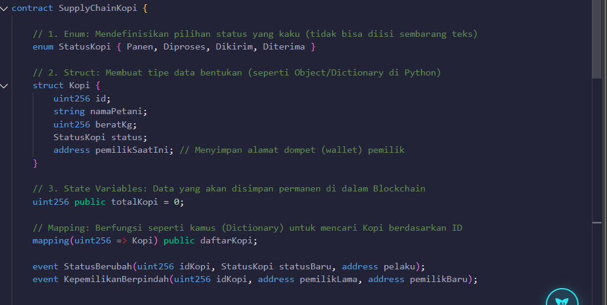
4. Membuat Pemicu / emit untuk event-event tersebut pada setiap perubahan status
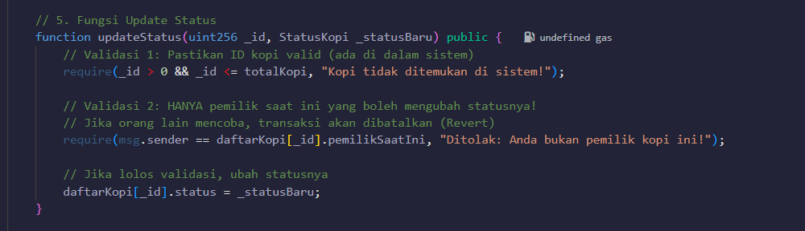
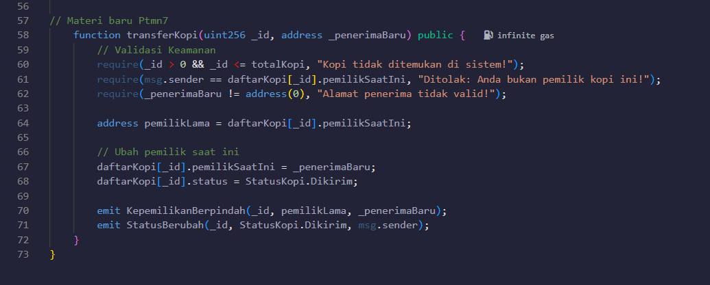
5. Membuat function updateStatus dan transferKopi
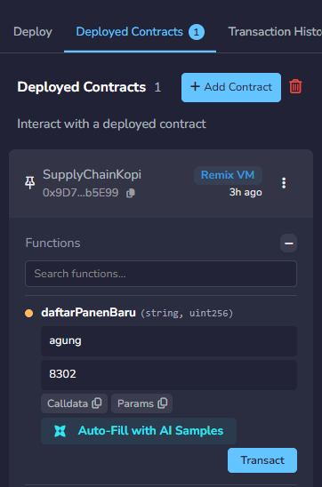
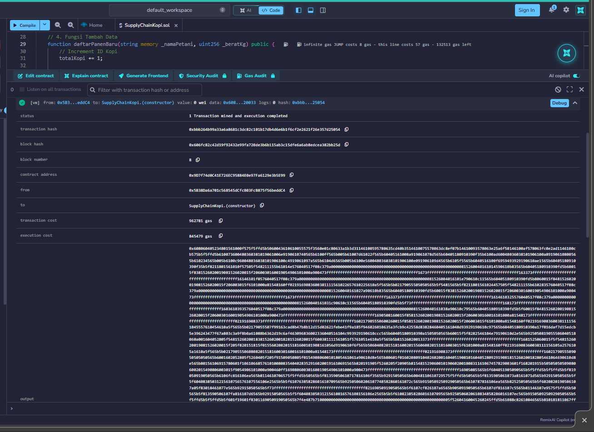
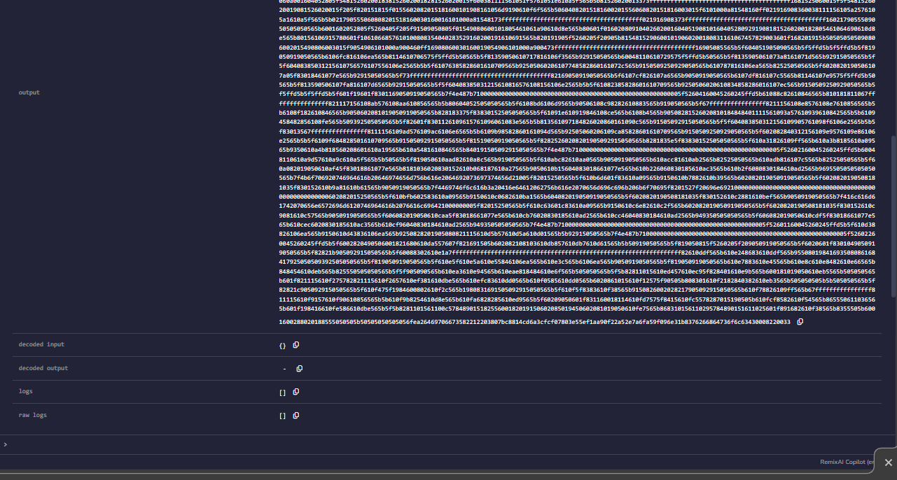
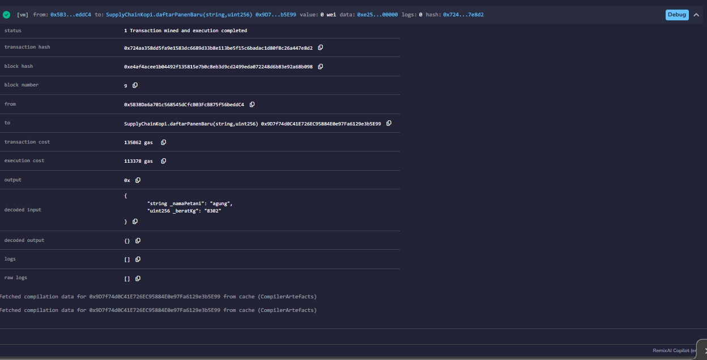
6. Uji Coba Konsep
- Daftar Panen Baru
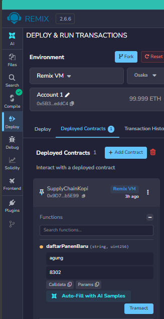
- Transfer Kopi Akun 1 (Petani) Ke Akun 2 (Distributor)
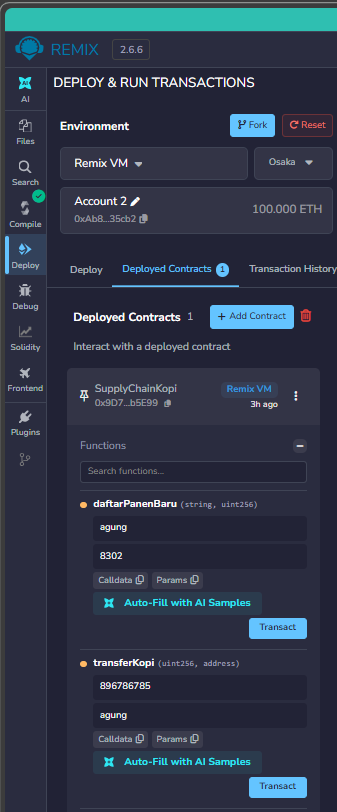
- Transfer Kopi Gagal Akun 1 (Petani) Ke Akun 2 (Distributor)
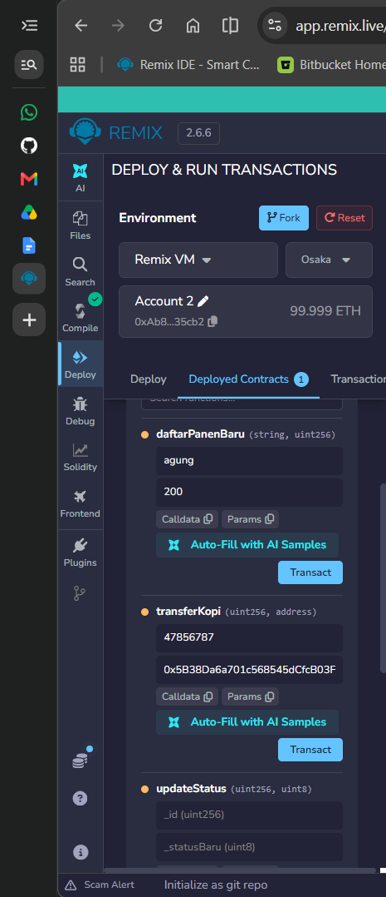
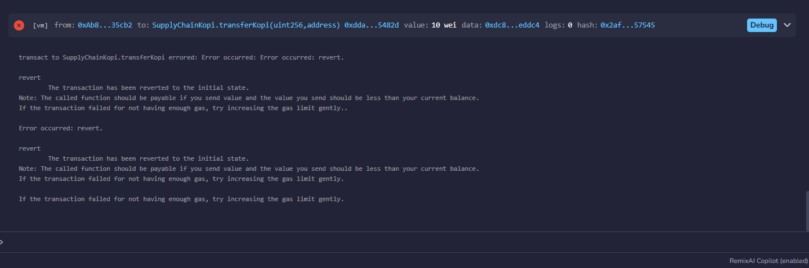
- Transfer Kopi dari Akun 2 (Distributor) Ke Akun 1
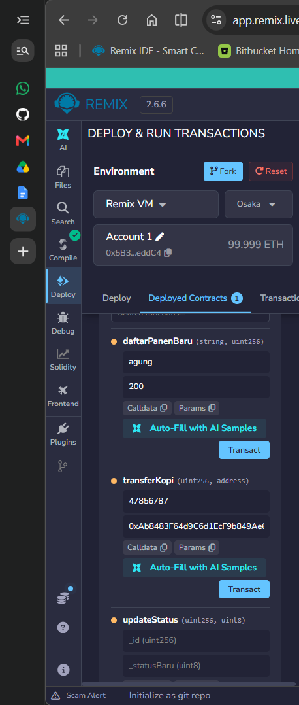
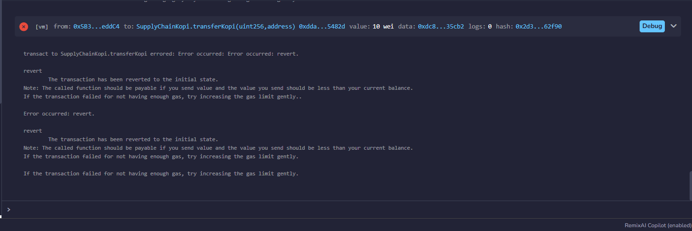