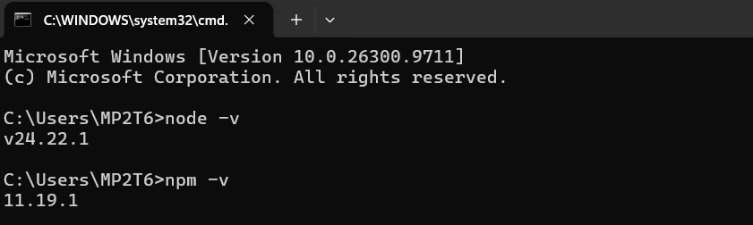
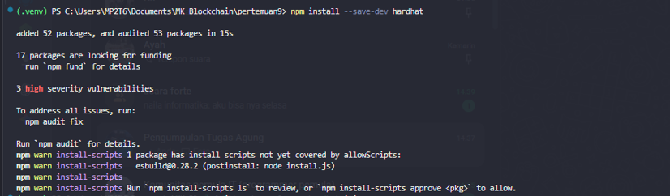
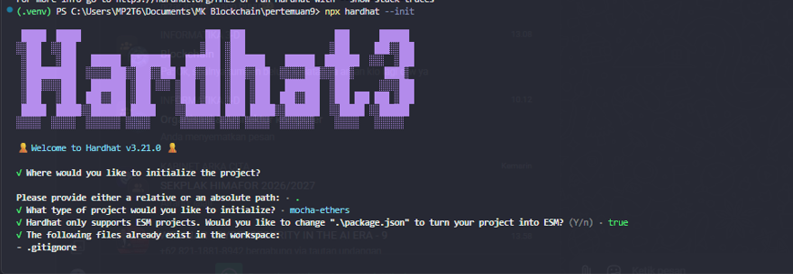

# INTEGRASI FRONT END DAN WEB3 #

## TUJUAN PRAKTIKUM ##
1. Mahasiswa memahami arsitektur dApp: frontend, wallet, provider (RPC node), dan smart contract.
2. Mahasiswa mampu menghubungkan aplikasi web ke wallet MetaMask (tombol Connect Wallet).
3. Mahasiswa mampu membaca data on-chain: address pengguna dan saldo ETH.
4. Mahasiswa mampu membaca satu data dari smart contract kelompoknya sendiri melalui ABI.
5. Mahasiswa memahami aturan keamanan wallet: seed phrase dan private key tidak pernah dibagikan.

## LANGKAH PRAKTIKUM ## 

1. Cek Instalasi Node dan Npm (node -v, npm -v)
2. Jika belum tersedia instal via https://nodejs.org/en/download
3. Bukti node js dan NPM



4. Buat folder baru nama dApps
5. Open Terminal dan CD Ke dalam folder tersebut
    ```bash
    mkdir dApps
    cd dApps
    ```
6. Inisialisasi npm
    ```bash
    npm init -y
    ```
7. Install framework Hardhat
npm install --save-dev hardhat
 
8. Menjalankan hardhart
