# INTEGRASI FRONT END DAN WEB3 #

## LANGKAH PRAKTIKUM ## 

1. Cek Instalasi Node dan Npm (node -v, npm -v)q
2. Jika belum tersedia instal via https://nodejs.org/en/download
3. Bukti node js dan NPM

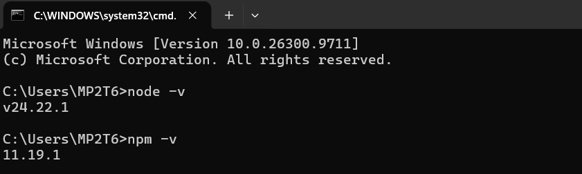

4. Buat folder baru nama dApps
5. Open Terminal dan CD Ke dalam folder tersebut
    ```bash
    mkdir dApps
    cd dApps
    ```
6. Inisialisasi npm
    ```bash
    npm init -y
    ```
7. Install framework Hardhat
npm install --save-dev hardhat

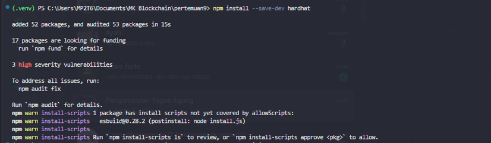 

8. Menjalankan hardhart(npx hardhart init)
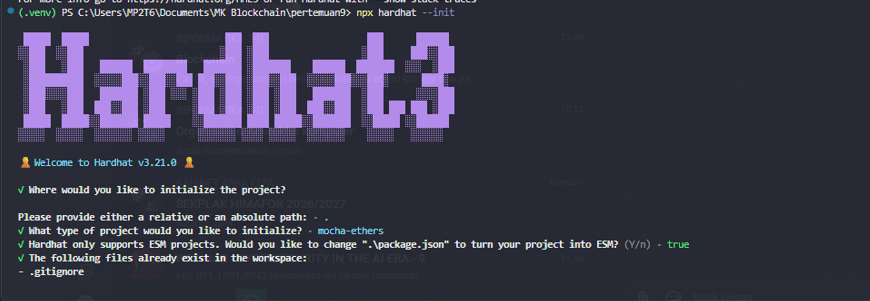

9. unduh dan tempatkan file smart contract yang sudah dibuat remix ke folder contract
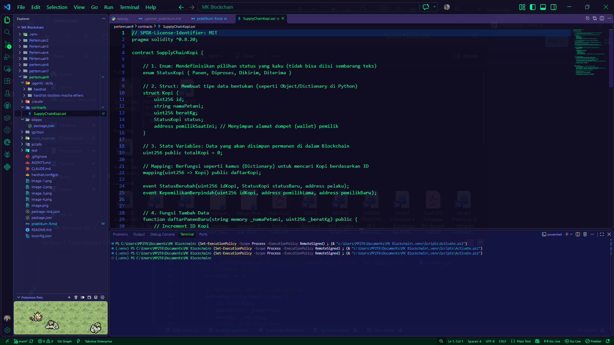

10. Compile projek dApps perintah ( npx hardhat compile )
    
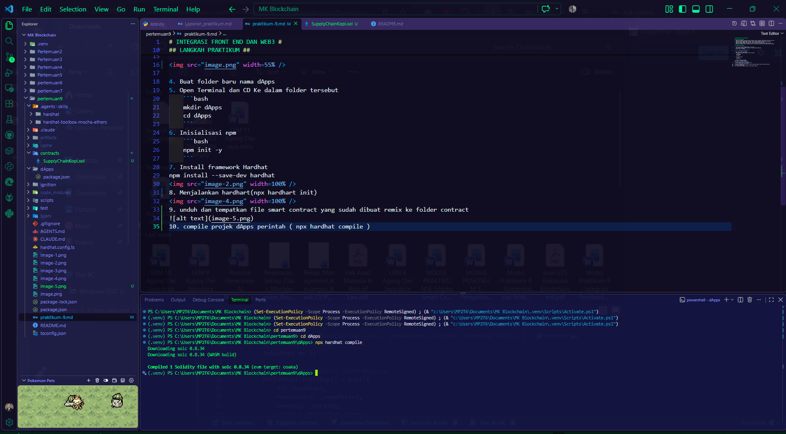


11. Menjalankan Node untuk mendapatkan aktor dan address (npx hardhat  --> node)
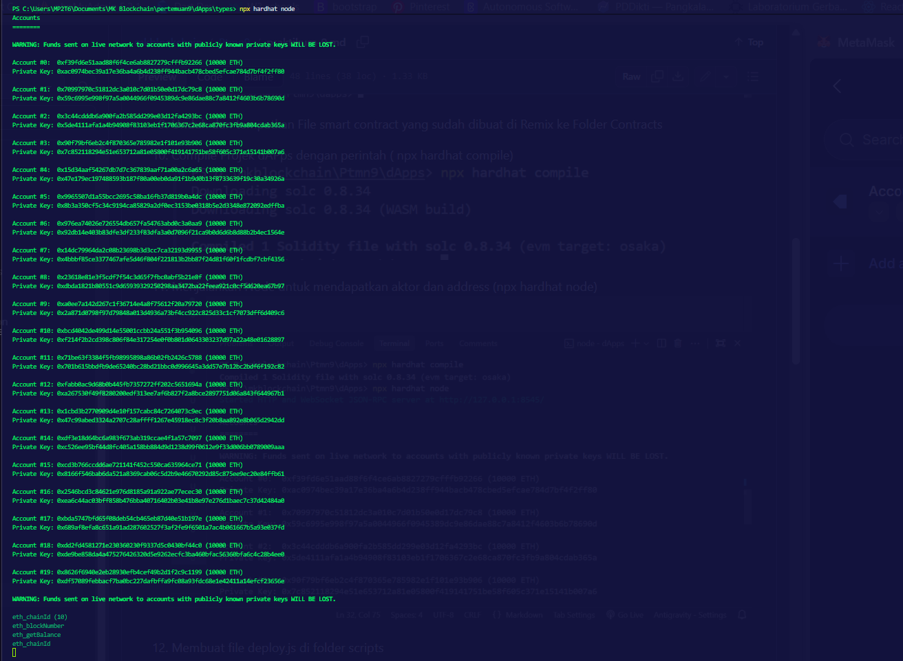

12. Membuat file deploy.js difolder scripts

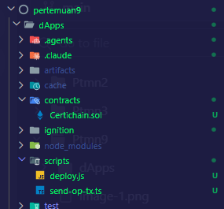

13. Deploy node ke local npx hardhat run scripts/deploy.js --network localhost

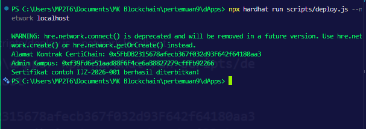

14. Membuat File index.html

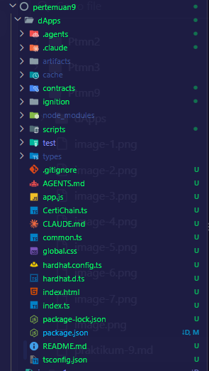

15. Install ekstension meta mask

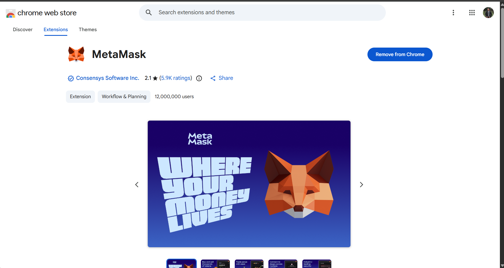

16. Login / Create Akun Via Oauth GMail
17. Create Custom Network dengan nama Hardhat Local
18. Import Custom account via private key (Private key di dapat di terminal VScode)
19. Jalankan Index.html (npx serve .)

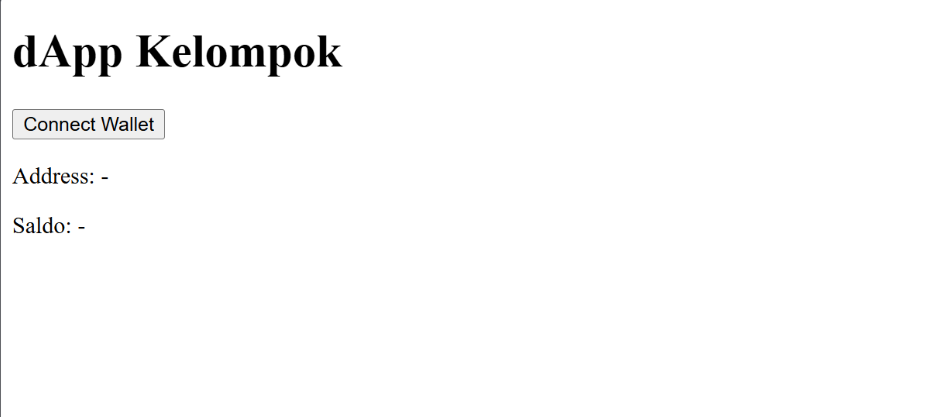

20. Hasil sudah Koneksi

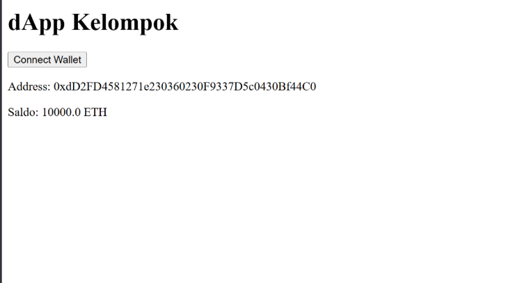